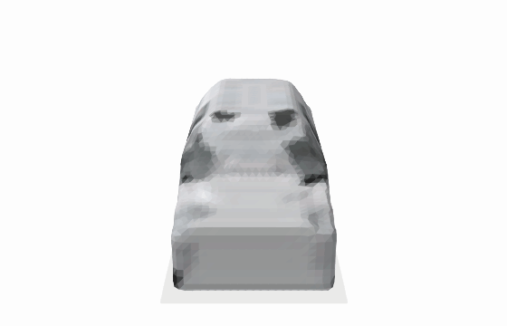

# Learning-Free 3D Triangulation of Moving Objects from a Single Roadside Camera

<i>A car of DAIR-V2X-C (clip 114_0) reconstructed from one fixed roadside camera. The colours are
the original pixels of the video.</i>

Monocular 3D perception for roadside cameras is almost always a learned box detector. This work recovers the 3D
**shape** of the cars that pass a fixed, calibrated camera with classical geometry only. A classical method finds
the mask and the 3D cuboid of every moving car in the video (background subtraction, optical flow, tangents from the
vanishing points). In short windows of the video every car is then triangulated and its planar motion and the depth
of every vertex are solved jointly; over the whole video the windows of one car are aligned in one car frame,
mirrored about its symmetry plane, averaged as a robust height field and completed by a visual hull of the
masks. No step is learned; LiDAR and 3D labels are used for evaluation only.

| Data (cars scored) | ours | labelled box | input cuboid | best single window |
| :--- | :---: | :---: | :---: | :---: |
| V2X-Seq-SPD example, intersection A (10; tuning) | 0.648 | 0.579 | 0.562 | 0.287 |
| DAIR-V2X-C example, intersection B (10) | 0.544 | 0.519 | 0.512 | 0.367 |
| five further clips of both datasets (34) | 0.615 | 0.647 | 0.615 | 0.290 |
| all (54) | 0.608 | 0.611 | 0.586 | 0.303 |

Mean solid IoU of the height fields against the cars' accumulated LiDAR with the gaps between scan lines closed; the
labelled boxes, the input cuboids of the classical method and the best single window are scored the same way on the
same cars, and every car counts once (two DAIR-V2X-C clips show the same video as V2X-Seq-SPD sequences and are
reported only as repeats). Over all cars the models are level with the labelled boxes (paired difference
-0.003 [-0.031, +0.025], 95 % bootstrap interval) and ahead of their input cuboids on the two intersections
(+0.085 [+0.027, +0.139] on A, +0.033 [+0.016, +0.052] on B; +0.022 [-0.005, +0.050] over all cars); their
surface is closer to the LiDAR in height than the cuboids' flat top (28 against 36 cm). The ablation shows that the
cabin carved from the silhouettes carries the method; a joint solve of all windows of a car as one rigid body did
not pay off with classical masks and is not part of the method. The main limits are the classical masks and cuboids and the coverage: 10 of the
24 cars of A with a LiDAR reference get a model. A pedestrian, a cyclist and a motorcyclist are shown as coarse
models from their silhouettes alone.

## Contents

- `main.tex` - the article (LNCS), `springer/` - the version for EURASIP Journal on Image and Video Processing
  (Springer Nature template, `scripts/sync_springer.py`), `references.bib`, `figures/`, `tables/`, `tables_cls/`.
- `code/` - a snapshot of the pipeline (from the research repository 3dseg), with its README.
- `scripts/` - tables and figures of the article from the results of the code.

Build: `latexmk -pdf main.tex`; the journal version: `python scripts/sync_springer.py` (copies the abstract and body of `main.tex` into `springer/main.tex`), then `latexmk -pdf main.tex`
in `springer/`.

## Reproducing the tables and figures

- Tables of the article: `scripts/make_tables_cls.py` writes `tables_cls/main_table.tex`, `tables_cls/clips_table.tex`,
  `tables_cls/ablation.tex` and `tables_cls/numbers.tex` from the per-clip results of the research repository 3dseg
  (`docs/whole_scene_cars_ann_<run>_<tag>.json`); do not edit them by hand. `tables/classical_input.tex` and
  `tables/compare.tex` are also used by the article.
- Figures of the article, all from the classical input: `scripts/teaser_figure.py` (`teaser.png`),
  `scripts/heading_figure.py` (`heading.png`), `scripts/method_figure.py` (`method_steps.png`),
  `scripts/cars_figure.py` (`cars_best.png`), `scripts/best_models_classical.py` (`best_models.png`),
  `scripts/lidar_reference_figure.py` (`lidar_reference.png`). The figures of intersection A need the captured models
  `figures/models_A_cls.pkl` (large, regenerable, not in git).
- Not used by the article any more: the other files of `tables/`, the figures `*_SLAM.png` and `vru_compare.png`, and
  their scripts (`make_tables.py`, `paired_ci.py`, `rerun_ablation.py`, `best_models_figure.py`,
  `vru_compare_figure.py`) belong to earlier experiments with masks and cuboids derived from the labels and LiDAR.
